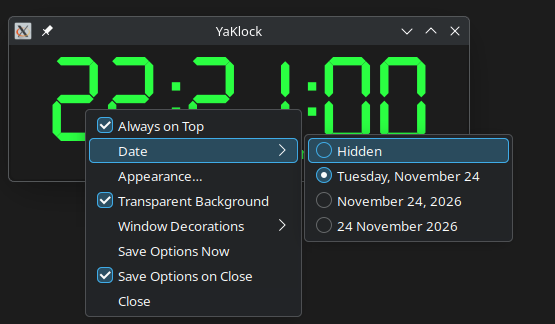

# YaKlock

YaKlock is a transparent, sticky digital clock for Ubuntu and Kubuntu desktops that keeps the time in sight and stays out of your way.

Resize it, keep it above your windows, adjust its opacity, or hide the decorations until only the digits remain. Right-click to customize it; YaKlock remembers your settings.

Developed and tested on Ubuntu 26.04 LTS with GNOME and KDE Plasma (Wayland sessions).


Track [known bugs](https://github.com/bjroberson/yaklock/issues?q=is%3Aissue+is%3Aopen+label%3Abug), [planned work](https://github.com/bjroberson/yaklock/issues), and [release milestones](https://github.com/bjroberson/yaklock/milestones).

## Install and run

### 1. Install dependencies

On Ubuntu or Kubuntu, install the packages YaKlock needs:

```bash
sudo apt update && sudo apt install -y git desktop-file-utils python3 python3-cairo python3-gi gir1.2-gtk-3.0
```

### 2. Get YaKlock

Download YaKlock into a new directory named `yaklock`:

```bash
git clone https://github.com/bjroberson/yaklock.git
```

### 3. Install YaKlock

Run this from the directory where you cloned YaKlock. It installs the clock, application-menu launcher, and icons for your user account:

```bash
(
set -e
cd yaklock
DATA_HOME="${XDG_DATA_HOME:-$HOME/.local/share}"
mkdir -p "$HOME/.local/bin" "$DATA_HOME/applications" "$DATA_HOME/icons"
install -m 755 yaklock "$HOME/.local/bin/yaklock"
desktop-file-install --dir="$DATA_HOME/applications" \
    --set-key=Exec --set-value="\"$HOME/.local/bin/yaklock\"" \
    io.github.bjroberson.yaklock.desktop
cp -R icons/. "$DATA_HOME/icons/"
)
```

### 4. Start YaKlock

Launch YaKlock from your application menu, or run:

```bash
"$HOME/.local/bin/yaklock" &
```

Right-click the clock to customize it. You can also pin YaKlock to your dock or panel from the application menu.

## Optional setup

### Start YaKlock at login

If you want YaKlock to start automatically when you sign in, run this after installing it:

```bash
(
set -e
AUTOSTART="${XDG_CONFIG_HOME:-$HOME/.config}/autostart"
mkdir -p "$AUTOSTART"
cp "${XDG_DATA_HOME:-$HOME/.local/share}/applications/io.github.bjroberson.yaklock.desktop" "$AUTOSTART/"
)
```

Launching YaKlock again opens an additional clock.

To disable automatic startup:

```bash
rm -f "${XDG_CONFIG_HOME:-$HOME/.config}/autostart/io.github.bjroberson.yaklock.desktop"
```

### Add a desktop shortcut

On KDE Plasma, you can add YaKlock to your desktop from the application menu. On GNOME, desktop shortcuts depend on your desktop-icons extension and may require allowing the launcher to run.

## Customize YaKlock

Right-click the clock to open its menu and appearance settings.

<p>
  
  
</p>

The checkout includes its window icons. Settings are saved in
`${XDG_CONFIG_HOME:-$HOME/.config}/yaklock/options.json`.
Each window loads the saved options when it opens. Saving updates only the
options changed in that window. If two windows change the same option, the
last save wins.

## Desktop environment

YaKlock has been tested on Ubuntu 26.04 LTS with GNOME and KDE Plasma in Wayland sessions.
The clock prefers XWayland when an X display is available so it can request
Always on Top. 


## License

Copyright © 2026 Brian Roberson.

YaKlock, including its launcher and bundled icons, is licensed under the GNU
General Public License, version 3 or any later version
(`GPL-3.0-or-later`). See [LICENSE](LICENSE).

## AI-assisted development

YaKlock is a personal project developed with help from OpenAI's
ChatGPT and Codex for design, coding, debugging, and testing.
The human maintainer sets the direction, reviews changes, performs
manual testing, and makes the final merge and release decisions.

Bugs are still bugs, regardless of who—or what—wrote them.
Please report them in [GitHub Issues](https://github.com/bjroberson/yaklock/issues).
