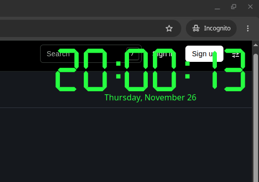

# YaKlock

A resizable Linux desktop clock with a green seven-segment display.



## Run from the checkout

The app uses Python 3, Pycairo, and PyGObject with GTK 3, GDK, GdkPixbuf, and GLib.
On Debian or Ubuntu, install them with:

```sh
sudo apt install python3 python3-cairo python3-gi gir1.2-gtk-3.0
./yaklock
```

Right-click the clock to customize its date, appearance, and Always on Top
setting, or to save your options.


The checkout includes its window icons. Settings are saved in
`${XDG_CONFIG_HOME:-$HOME/.config}/yaklock/options.json`. YaKlock starts with
fresh settings alongside an existing Seven-Segment Clock installation.

## Desktop launcher

For an application-menu entry, place the executable in a directory on your
desktop session's `PATH`. Copy `io.github.bjroberson.yaklock.desktop` to
`${XDG_DATA_HOME:-$HOME/.local/share}/applications/` and merge the contents of
`icons/` into `${XDG_DATA_HOME:-$HOME/.local/share}/icons/`.

## Desktop environment

The development environment is KDE Plasma on Wayland on Ubuntu 26.04 LTS.
The clock prefers XWayland when an X display is available so it can request
Always on Top. The release checkout still needs a graphical smoke test on that
desktop. Rendering and settings were tested independently of the installed app.

## License

Copyright © 2026 Brian Roberson.

YaKlock, including its launcher and bundled icons, is licensed under the GNU
General Public License, version 3 or any later version
(`GPL-3.0-or-later`). See [LICENSE](LICENSE).
