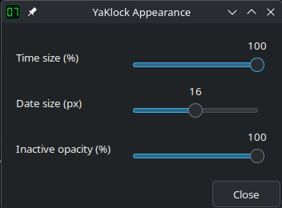

# YaKlock

YaKlock is a transparent, sticky digital clock for your Linux desktop that keeps the time in sight and stays out of your way.

Resize it, keep it above your windows, adjust its opacity, or hide the decorations until only the digits remain. Right-click to customize it; YaKlock remembers your settings.

Developed and tested on KDE Plasma.


## Run from the checkout

The app uses Python 3, Pycairo, and PyGObject with GTK 3, GDK, GdkPixbuf, and GLib.
On Debian or Ubuntu, install them with:

```sh
sudo apt install python3 python3-cairo python3-gi gir1.2-gtk-3.0
./yaklock
```

Right-click the clock to customize its date, appearance, and Always on Top
setting, or to save your options.



The checkout includes its window icons. Settings are saved in
`${XDG_CONFIG_HOME:-$HOME/.config}/yaklock/options.json`. YaKlock starts with
fresh settings alongside an existing Seven-Segment Clock installation.

## Desktop launcher

For an application-menu entry, place the executable in a directory on your
desktop session's `PATH`. Copy `io.github.bjroberson.yaklock.desktop` to
`${XDG_DATA_HOME:-$HOME/.local/share}/applications/` and merge the contents of
`icons/` into `${XDG_DATA_HOME:-$HOME/.local/share}/icons/`.

## Desktop environment

The development environment is KDE Plasma on Wayland on Ubuntu 26.04 LTS.
The clock prefers XWayland when an X display is available so it can request
Always on Top. 


## License

Copyright © 2026 Brian Roberson.

YaKlock, including its launcher and bundled icons, is licensed under the GNU
General Public License, version 3 or any later version
(`GPL-3.0-or-later`). See [LICENSE](LICENSE).

## AI-assisted development

YaKlock is a personal project developed with help from OpenAI's
ChatGPT and Codex for design, coding, debugging, and testing.
The human maintainer sets the direction, reviews changes, performs
manual testing, and makes the final merge and release decisions.

Bugs are still bugs, regardless of who—or what—wrote them.
Please report them in [GitHub Issues](https://github.com/bjroberson/yaklock/issues).
